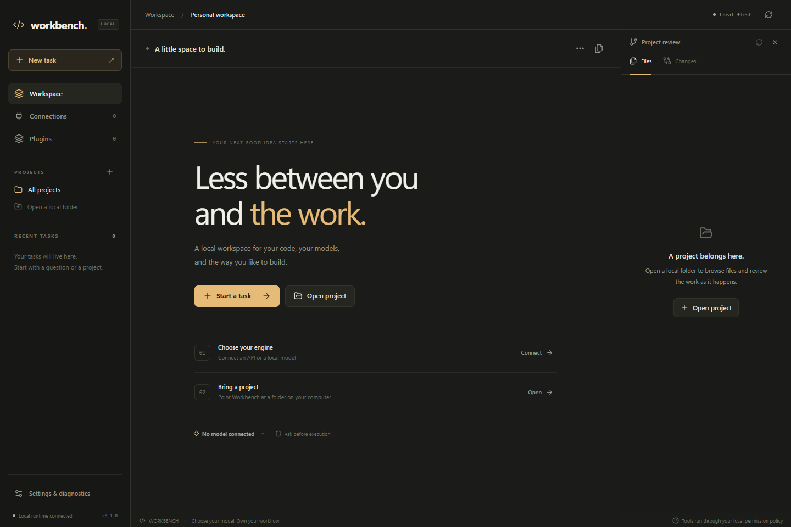

# Workbench

Your models. Your tools. Your workspace.

A Windows-first desktop coding agent built with Rust, Tauri and React. Model connections, the agent runtime and installable skills/MCP plugins are separate systems. The desktop and local browser/CLI entry points use the same Rust backend.



[Download Windows preview](https://github.com/RobertIonutF/Workbench/releases/tag/v0.2.0) · [Feature guide](docs/FEATURES.md) · [Architecture](docs/ARCHITECTURE.md) · [Contributing](CONTRIBUTING.md) · [MIT license](LICENSE)

## Run

Download the Windows x64 installer or portable ZIP from [Releases](https://github.com/RobertIonutF/Workbench/releases). Install Workbench, or extract the portable ZIP and run `Workbench.exe`. The release executable embeds the frontend; it does not require Node.js or Rust on the user's machine. Windows WebView2 is required; the installer handles its runtime bootstrap when necessary. The initial release is unsigned. Release files include SHA-256 checksums.

First run:

1. Open **Connections** and add an API account or local server. LM Studio defaults to `http://127.0.0.1:1234/v1`; start its server first. Other presets include OpenAI Responses, Anthropic Messages, Gemini and Ollama/custom OpenAI-compatible APIs.
2. Save the connection, discover models or enter the exact API identifier manually, then run the connection probe. A probe generates real requests and checks text, streaming and a harmless structured tool round trip.
3. Open a project folder and create a task with the chosen connection/model.
4. Start in **Ask** or **Read only** mode. Review requested file changes, command invocations and plugin launches in the approval interface.
5. Install or create plugins in **Plugins** and select their skills/tools in the task options.

No model weights, paid API credits or provider credentials are bundled. A configured endpoint is not represented as verified until its test succeeds.

## New in 0.2

- **Control center:** save model profiles, compare real responses, inspect usage, run agent teams, manage Git worktrees and pull requests, edit project memory, configure workflow checks and scheduled tasks, or use the interactive terminal.
- **Workspace:** syntax-highlighted editor tabs, side-by-side diffs, hunk review with comments, file/symbol context, image/PDF attachments, task plans, pause/resume, steering, queued messages and conversation forks.
- **Plugin Studio:** schema-driven tool forms, resources/prompts, saved regression cases and redacted traces, model-assisted plugin creation, pinned catalog packages, managed local previews and browser assertions, encrypted backups and signed update checks.

These actions use the Rust runtime and actual files, processes or network requests. API calls and capability probes may incur provider charges. The desktop can keep jobs running in the tray when background mode is enabled; schedules run while Workbench is open, and missed intervals are not replayed in a burst.

## Plugins

Workbench loads portable Agent Plugins 1.0.0 packages with root `plugin.json`, `skills/<name>/SKILL.md` and optional `mcp.json`. Supported Codex/Claude compatibility layouts are imported with diagnostics for unsupported components. Host connector accounts, executable hooks and subagent definitions are not silently transferred.

Use **Create plugin** for skill-only, MCP-only or combined packages. Rust templates can be built from the creator; Python and JavaScript companions run directly with their respective installed runtimes. The generated calculator operation performs real arithmetic and can be tested with an MCP client. It is an authoring starting point, not a fabricated implementation of your eventual domain tools.

Install from a folder or ZIP. Installed versions are copied to immutable, content-addressed directories. Editing a skill saves its author source; **Update** activates a new installed version after review. Updates are disabled until explicitly enabled. Rollback retains the previous package; mutable plugin data is separate. Changes are blocked while active runs would make an update unsafe.

Use `@plugin-name` or `/plugin-name:skill-name` in a message, or the task option selectors. Automatic skill selection is optional in Settings. Loading instructions does not grant execution authority. Selected skills can read their packaged references; packaged helper execution requires explicit native approval.

Local MCP uses stdio; remote MCP uses Streamable HTTP. The runtime negotiates protocol versions and exposes validated tools to the selected model. Large tool catalogs are searched locally through an ordinary `find_tools` function. Remote bearer tokens and supported public-client DCR OAuth are configured outside the package and bound to the exact service URL.

## Authentication and execution boundaries

- Windows credentials are encrypted with user-bound DPAPI under the local Workbench data directory. They do not enter model prompts, public connection responses or configuration exports. An OS user's own native code can still access that user's authority; encryption is not a process sandbox.
- ChatGPT uses the documented local/open-source Sign in with ChatGPT flow: system browser, loopback callback, state/nonce/PKCE, issued client registration, signed identity validation, scope checks and encrypted token refresh.
- Anthropic's native connection uses API credentials. Workbench does not collect Claude subscription session tokens or present an unofficial Claude.ai login.
- Remote MCP OAuth implements the public-client dynamic registration subset. CIMD-only, confidential-client or pre-registration-only services produce a specific unsupported-flow diagnostic. Account-dependent live sign-in requires the user's participation.
- **Ask** approves mutations and commands; **Read only** withholds them; **Trusted native** grants native project command authority; **Docker** uses a separately prepared `python:3.12-slim` image with no network, no host credentials and only the chosen project mounted. Workbench never silently substitutes native execution for unavailable isolation. Native MCP processes and packaged scripts require their own approval and are unavailable in Docker mode.
- Checkpoints preserve preimages and compare current contents before undo. Newer user edits cause a conflict instead of being discarded. General commands/external tools cannot guarantee exactly-once side effects; review interrupted work before retrying.

The application binds its API only to loopback and requires a random session capability on API requests. Browser mode receives it through a one-time URL fragment; native mode obtains it through the local Tauri command. Do not publish private browser capability URLs. API credentials are never reused across changed endpoints or cross-origin redirects.

## Develop

Prerequisites: Rust 1.96+, Node.js 24+, MSVC C++ build tools and WebView2 for the Windows desktop build.

```powershell
npm ci
npm run check
npm run build
cargo test -p workbench-core
cargo clippy --workspace --all-targets -- -D warnings
npm run bundle
```

Clone this repository and run these commands from its root. `npm run bundle` produces the installer in `target/release/bundle/nsis/`.

The native app is `target/release/Workbench.exe`; the CLI is `target/release/workbench-cli.exe`. A browser-only local session can be started with:

```powershell
cargo run -p workbench-core -- serve --open
```

For a Vite development window, use `npm run tauri -- dev`. Use a distinct `--data-dir` or `WORKBENCH_DATA_DIR` for isolated tests. The runtime locks its data directory; two runtimes must not operate on the same database concurrently.

When the desktop is already running, the CLI connects to its authenticated local runtime. The installer includes `workbench-cli.exe` beside `Workbench.exe`; run it from that directory or add the directory to your PATH. The portable ZIP also includes `ui/` for browser mode.

Example CLI authoring:

```powershell
workbench-cli plugin init C:\Plugins\repo-tools --name repo-tools --template combined --language rust
workbench-cli plugin build C:\Plugins\repo-tools
workbench-cli plugin check C:\Plugins\repo-tools
workbench-cli plugin install C:\Plugins\repo-tools
workbench-cli plugin list
workbench-cli plugin test <installed-plugin-id>
workbench-cli plugin pack <installed-plugin-id> --out C:\Exports\repo-tools.zip
workbench-cli plugin dev C:\Plugins\repo-tools
workbench-cli chat "Explain this project" --project C:\Projects\my-app --read-only
```

The CLI prints JSON diagnostics and real results. Plugin testing launches its declared server with native authority; run only packages you intend to execute.

The creator also wraps an existing MCP command and argument list, or a Streamable HTTP URL. It discovers the server's actual tools. `plugin dev` reloads source changes between turns; a changed MCP configuration requires review and re-enabling. Headless chat uses an existing saved connection, with optional `--connection` and `--model` identifiers, and asks for approvals in the terminal.

Run `powershell -File scripts/package.ps1` to build and create installer, portable and source artifacts under `output/release/`, with SHA-256 hashes. See `docs/ARCHITECTURE.md` for the code map.

## Verification and scope

See `docs/VERIFICATION.md` for actual checks and limitations. Deterministic tests and UI fixtures do not establish a live account entitlement or guarantee a particular model's coding quality.

Version 0.2 adds model profiles and comparisons, usage and budgets, interactive terminals, task steering and forks, context attachments, agent teams with Git worktrees, review and PR publishing, scheduled jobs, Plugin Studio, a pinned plugin catalog, local browser tests, encrypted profile backups, and verified updates. See the [feature guide](docs/FEATURES.md) for workflows and precise boundaries. A hosted multi-user marketplace, remote worker fleet, mobile clients and official third-party engine bridges remain separate work.

Workbench's implementation is independently authored and does not redistribute the Codex application. Original Workbench code is MIT-licensed; bundled dependencies and Agent Plugins schemas retain their upstream licenses in [THIRD_PARTY_NOTICES.txt](THIRD_PARTY_NOTICES.txt).
